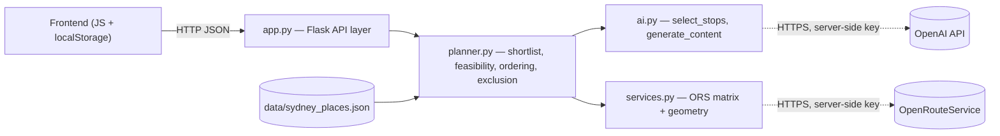

# Architecture Spine — Jaunt frontend-wiring slice

## Design Paradigm

**Stateless pipes-and-filters.** Each trip request runs a fixed, ordered sequence of pure stages — shortlist → routing matrix → feasibility enumeration → AI stop selection → AI content generation — producing one complete response. No stage holds state between requests; the Flask layer (`app.py`) is a thin adapter over `planner.py`/`ai.py`/`services.py`, never a session store. The browser is the sole holder of state *across* requests (current trip, visit history), persisted to `localStorage`.



Dependency direction is one-way: Browser → API → Planner → {AI, Services} → external providers. Nothing downstream calls back up; the browser never talks to AI/Services/providers directly, and never sees a provider key.

## Invariants & Rules

### AD-1 — Map rendering [ADOPTED]

- **Binds:** all map UI (base layer, route line, stop/park/live-position styling, background amenity points — FR-23)
- **Prevents:** one builder styling raster OSM tiles while another assumes a MapLibre vector style exists; re-deriving map colors from `DESIGN.md`'s token table independently of the real style document; one builder drawing many-of-a-kind map features as individual DOM markers while another assumes a single data-driven layer
- **Rule:** MapLibre GL JS (pinned `5.6.1` — v6 drops the UMD script-tag bundle this buildless project relies on), base style OpenFreeMap `positron` (free, no API key, no request limit). A custom style forked from OpenFreeMap and matched to `DESIGN.md`'s exact palette, authored via Maputnik, is follow-up work — not yet done. **Status: base layer implemented and user-verified** (`templates/index.html`, `static/app.js`, 2026-10-07) — the route line, stop markers, live-position marker, and amenity dots below are not yet built.
  - Many-of-a-kind, data-driven features (the route line, background amenity points — FR-23, park fills, numbered stop circles with no photo) render as GeoJSON sources + MapLibre paint layers (line/circle/fill), not individual DOM markers — this is MapLibre's idiomatic fit for data that changes per-request and doesn't need custom image content.
  - One-off features needing real image content (the live-position marker — a crop of Jarrod's head, not a redrawn dot; a rights-cleared-photo stop pin) use `maplibregl.Marker({element})` with a custom DOM element, the same pattern already established for the start-point marker in `static/app.js`.
  - Whichever rendering mechanism a given stop uses (GeoJSON circle, or a DOM photo-pin Marker), it carries the same place `id` as its one addressable key — click/selection/highlight code never needs to know which mechanism rendered a given stop.
  - **Known non-compliant scaffolding:** `static/app.js`'s existing catalogue-marker loop (`loadPlaces()`) already renders every catalogue place as an individual `maplibregl.Marker()` — technically the pattern this rule's first bullet prohibits. This predates the rule and was ported 1:1 from the Leaflet version to preserve existing behavior exactly, per explicit instruction; it is not retroactively required to change. This rule binds *new* map features being built (route line, amenity dots, numbered stop circles), not a rewrite of already-working Sprint-2 scaffolding.

### AD-2 — State ownership [ADOPTED]

- **Binds:** every endpoint and screen across the multi-step flow (setup, loading, route review, walking, end)
- **Prevents:** one builder adding Flask server-side session state while another assumes statelessness; a reload silently losing an in-progress trip with no recovery path
- **Rule:** backend stays fully stateless — one planning request returns the complete route+stops+content; follow-up actions (replace a stop, mark visited) are separate stateless requests taking current state as input, never reading server memory. The frontend persists the active trip to its own `localStorage` key so an accidental refresh doesn't lose progress; an explicit "end trip" action clears *that key only*. Visit history (AD-6) lives under a **separate** `localStorage` key and is never touched by "end trip" — ending a trip must not silently erase the cross-trip history AD-6 depends on.
  - **"End trip" fires at wrap-up completion, not at the "End Jaunt" button press.** `EXPERIENCE.md`'s End Jaunt flow opens a catch-up screen (retroactive Visited marking) and then an optional FR-16 summary *before* the trip actually ends — the active-trip state must stay alive through that whole sequence so a refresh mid-wrap-up still recovers correctly. The clearing event is wrap-up finishing (summary shown, or "end without a summary" taken) or an explicit return to setup — never the initial hamburger-tap.
  - **The Visited control (FR-13) is context-gated, not always-on.** The same stop-info overlay is shown both pre-walk (FR-7 preview) and during the walk, but FR-13 requires the Visited signal be "only actionable during an active walk" — a Stop merely previewed pre-walk must never be recordable as `visited_completed` (AD-6). The overlay's Visited control must know which context it's rendered in and disable/hide itself outside an active walk.

### AD-3 — AI content-generation timing [ADOPTED]

- **Binds:** `ai.py`'s content-generation function (FR-19, not yet built), the planning response shape
- **Prevents:** wiring content generation as a per-stop-open lazy call while another part of the system assumes the full trip payload is already complete and cacheable — two incompatible shapes for the same `localStorage`-persisted trip (AD-2)
- **Rule:** content generation for every stop in the chosen route runs synchronously inside the same planning step that selects the stops, before the route is returned. One complete payload goes to the frontend and into `localStorage`. Chosen explicitly over the lazier, cheaper alternative to keep the walk itself working if connectivity drops.
  - **Payload shape** (binding, not just naming): each stop in the payload carries its own `id`, position in the walking order, generated `content` text, and a **structured attribution reference** (`source_type`/`source_title`/`source_url`) — never a flat `content` string with no attribution field, since FR-20 requires per-source attribution in the UI. Exact field *names* are still implementation detail (see Deferred); this shape is not.
  - **Per-stop grounding-check failure (FR-19) does not fail the whole route.** If one stop's generated content fails its automated grounding check, that stop falls back to its raw `source_excerpt` as-is (no AI embellishment, clearly real) rather than the whole otherwise-feasible route being discarded or surfaced as a system failure. This keeps AD-3's resilience goal intact and avoids inventing an undocumented per-stop error marker.

### AD-4 — Preference-signal mechanism (FR-4) [ADOPTED]

- **Binds:** how the landmark ↔ hidden-gem preference reaches stop selection
- **Prevents:** inventing a Python-computed "prominence" heuristic (e.g. keyed off `source_type`) while another part of the system assumes AI alone judges it from the content it already sees — two different signals that could rank the same shortlist differently
- **Rule:** no new Python-computed prominence field. The preference value passes into AI's existing selection prompt alongside each candidate's real `source_type`/`source_title`/content; AI leans its pick accordingly as part of the same qualitative judgment call it already makes. Matches the architecture boundary `docs/architecture-plan.md` already ratified: Python owns facts/arithmetic, AI owns qualitative judgment, never the reverse.
  - **Not yet true today — a required change, not a given:** `planner.py`'s `_build_ai_options()` currently sends only `id`/`name`/`topics`/`source_excerpt` to AI, not `source_type`/`source_title`. Implementing this AD requires *adding* those fields to that payload; a builder who takes "existing prompt" at face value and skips this recreates the exact divergence this AD exists to prevent.
  - **Wire representation:** the preference travels as a single numeric value reflecting the slider's exact position (matching the continuous handle in `DESIGN.md`'s preference-control mock), not quantized into a 3-value enum. Python does no arithmetic on it beyond passing it into AI's prompt as plain-language guidance.

### AD-5 — Replace / Re-Jaunt exclusion (FR-10, FR-11) [ADOPTED]

- **Binds:** `planner.py`'s shortlisting/selection path
- **Prevents:** an implementation that re-calls `plan_route()` unchanged and calls it "replace" — `prd.md` explicitly warns this doesn't guarantee a different result; one builder treating `excluded_ids` as the same list as AD-6's visit history while another treats them as two unrelated lists
- **Rule:** the selection path takes an `excluded_ids` parameter — a **hard filter**, distinct from AD-6's visit history (different list, different purpose: this one is the current trip's own session-local rejects, not cross-trip history). It lives in the active-trip `localStorage` object (AD-2) and is cleared by "end trip" along with the rest of that object. Replacing a stop or Re-Jaunting re-runs with the rejected stop(s) added to that exclusion list, and re-validates time feasibility before the new route can be approved (FR-11's explicit requirement). Since the backend is stateless (AD-2), the frontend resends the **full accumulated** `excluded_ids` list on every call, never a delta.
  - **Deliberate, acknowledged trade-off:** Re-Jaunt excluding every stop in the rejected route is stricter than FR-10's own testable wording ("a different route... when a feasible alternative exists in the Option Menu") technically requires — a menu containing `{A,B}` and `{A,C}` would lose the valid `{A,C}` alternative after rejecting `{A,B}`, since excluding A removes it from the shortlist entirely. Confirmed, not overlooked: kept as-is by explicit user decision — Re-Jaunt is the "I don't want any of this" clean break, while FR-11's separate per-stop removal is already the precise tool for keeping most of a route and swapping one thing. Accepted consequence: Re-Jaunt falls back to FR-9's honest "no suitable route" message somewhat more often than the strictest reading of FR-10 would require.

### AD-6 — Visit history (FR-17, FR-18) [ADOPTED]

- **Binds:** how local visit history/favourites reach Python's ranking
- **Prevents:** one builder adding a server-side *store* (file, session, or otherwise persisted) for visit history while another assumes it's purely transient per-request — two incompatible places for the data to live; one builder hard-filtering visited/favourited places out of future routes while another assumes favourites can resurface (`EXPERIENCE.md`'s explicit design intent) or visited places are only soft-weighted, not excluded; one builder collapsing the four Engagement States into a single "seen" flag, which FR-17 explicitly prohibits
- **Rule:** canonical storage is a **separate `localStorage` key from the active trip** (AD-2), not the same object, so "end trip" never touches it. **Schema (corrected 2026-10-07 — the original `{id, favourited}` shape silently collapsed FR-17's required distinction):** a list of `{id, state, favourited}` entries, where `state` is one of the three ordinal Engagement States — `proposed` / `opened_engaged` / `visited_completed` (PRD Glossary) — and `favourited` is an independent boolean, never merged into `state`. Sent with the planning request as a **soft signal only** per `prd.md`'s revised §7 (2026-10-07): transient, this-request-only, never persisted server-side in V1 — `ai.py`'s selection prompt uses it to weight toward variety, deprioritizing `visited_completed` more strongly than `opened_engaged` or merely-`proposed` (FR-18), while a `favourited` place is never excluded regardless of its `state`. No server-side storage in V1; a future server-side account system (addendum.md) is explicitly not foreclosed by this AD.

## Consistency Conventions

| Concern | Convention |
| --- | --- |
| Naming (entities, files, interfaces, events) | Place/stop identity is the catalogue's existing `id` field (OSM-derived or source-row-derived) end to end — frontend, API payloads, and `excluded_ids`/history lists never mint a second id scheme. |
| Data & formats (ids, dates, error shapes, envelopes) | JSON request/response bodies throughout. An ordinary "no suitable route" outcome is a normal `200` whose body carries `{"feasible": false, "reason": ...}`. Non-2xx status codes are reserved for genuine system failures (catalogue unavailable, AI credentials/quota failure — mirrors `app.py`'s existing `CatalogueError` → `503` pattern). **Required code change, not yet true (2026-10-07 correction):** `planner.py`'s `plan_route()` currently returns this *same* `{"feasible": false, ...}` shape for a genuine `ai.AiFatalError` (invalid credentials, exhausted quota) as it does for an ordinary infeasible request — there is no field distinguishing them today, and the convention above (200 vs non-2xx) cannot be implemented against `app.py` without parsing free-text `reason`, which this convention explicitly rules out. Before the planning endpoint is built, `plan_route()` must stop swallowing `AiFatalError`/non-retryable failures into `_plan_failure`'s shape — re-raise them (mirroring how `CatalogueError` already propagates) so `app.py` can map them to a real non-2xx status without string-matching. |
| State & cross-cutting (mutation, errors, config, auth) | Backend is stateless (AD-2); the browser is the sole cross-request state holder via two separate `localStorage` keys — active trip (AD-2) and visit history (AD-6), never merged. Provider keys (OpenRouteService, OpenAI) are read server-side via `.env`/`load_env()`/`get_api_key()` — the pattern `services.py`/`ai.py` already establish; any new endpoint follows it, never invents a second secrets path, never exposes a key to the browser. Logging is not addressed by this spine — no decision made, not a settled "none needed." |

## Stack

| Name | Version |
| --- | --- |
| Python | 3.13 |
| Flask | 3.1.3 (installed; `requirements.txt` leaves it unpinned — pre-existing practice, unchanged by this spine) |
| MapLibre GL JS | 5.6.1 (pinned) |
| OpenFreeMap (vector tiles) | public instance, `positron` style, no key |
| OpenRouteService | foot-walking profile, keyed, server-side only |
| OpenAI | model configurable via `OPENAI_MODEL` env var |

## Structural Seed

```text
app.py              # Flask API layer — thin adapter, no business logic, no state
planner.py          # shortlist, routing-matrix request, feasibility, ordering, exclusion (AD-5)
ai.py               # select_stops() [built]; generate_content() [FR-19, not yet built] + grounding check
services.py         # external routing calls — duration matrix [built], route geometry [Sprint 8, not yet built]
templates/, static/ # MapLibre frontend (AD-1); trip state in localStorage (AD-2, AD-6)
data/sydney_places.json  # catalogue, read-only at request time
import_*.py          # offline catalogue builders — out of this slice's scope, unchanged
```

**Deployment & environment:** local-only for V1 (`python3 app.py`), confirmed via `README.md`'s Setup & Run section. No hosting/infra provider — this is a course project graded by local run/demo, not a hosted service.

## Capability → Architecture Map

| Capability / Area | Lives in | Governed by |
| --- | --- | --- |
| Map rendering, route/stop visual styling, background amenity points (FR-23) | `templates/index.html`, `static/app.js` | AD-1 |
| Trip state across setup → walking → end | browser `localStorage` | AD-2, AD-6 |
| Stop content ("fun fact"/story/task), FR-19 | `ai.py` (new function) | AD-3 |
| Landmark ↔ hidden-gem preference, FR-4 | `ai.py`'s existing selection prompt | AD-4 |
| Replace a stop / Re-Jaunt, FR-10/FR-11 | `planner.py`'s selection path | AD-5 |
| Route-geometry display, FR-6 | `services.py` (new function) + frontend | inherited pattern (see Deferred) |
| AI grounding check, FR-19 | `ai.py`'s new content function | new logic needed (see Deferred correction) |

## Deferred

- **Route-geometry fetch (Sprint 8)** is not treated as a new architecture fork — it extends an already-ratified module boundary (`services.py`'s existing ORS-auth pattern) rather than introducing a new one.
- **Correction (2026-10-07, architecture review):** FR-19's automated grounding check was previously described here as "extending `ai.py`'s existing validation pattern from `select_stops()`," implying it's a small, mechanical addition. That's wrong and understated the PRD's own framing (FR-19, "still the largest unbuilt piece"): `select_stops()`'s current validation only checks that returned JSON parses and `selected_option` is one of the offered keys — pure structural/schema validation, with zero capability to judge whether generated *prose* is actually supported by source material. Only the *placement* (inside `ai.py`, before content returns) is an extension of the existing pattern; the grounding-check *mechanism itself* is new, substantial, unbuilt logic with no existing analogue in this codebase. **Recommended as an early Must-tier prototype task** (per review), with real supported/unsupported examples and documented limitations, applied to AI-generated walk summaries (FR-16) too, not just per-stop content.
- **Attribution/UI requirements** for OSM, the routing provider, and Wikipedia (`docs/architecture-plan.md`'s own narrower "Still-open decisions" list) **plus NSW Heritage and Inner West Council** (named by `prd.md` FR-20, a fuller requirement than architecture-plan.md's original list) — a content/UI requirements question for `bmad-create-epics-and-stories`, not an architecture-level fork.
- **Full custom MapLibre style matching `DESIGN.md`'s exact palette** — AD-1 ships the free `positron` approximation now; forking and recoloring it via Maputnik is separate, later work.
- **Exact `/api/...` endpoint names and payload field *names*** (not shape — AD-3 now pins the stop payload's shape, and FR-20 attribution's structured-vs-flat requirement) — straightforward to derive from `planner.py`'s existing return shapes once written; not a genuine two-builder divergence risk, left to epic/story-level detail.
- **Logging strategy** — not addressed by this spine at all (see Consistency Conventions). Not assumed to be "none needed" — a real gap, left open rather than silently decided either way.
- **FR-1** (starting point) — **revised 2026-10-18:** the "tap outside the Pilot Area is rejected" consequence this bullet used to name was dropped from the PRD after confirming no runtime boundary check exists anywhere in the code (`import_places.py`'s `PILOT_BBOX` is import-time only); a start point far from any real Stop is handled by the existing honest-fallback path (FR-9), not a separate rejection. Remaining FR-1 detail (named-start chips, copy) is still input-validation/copy-level, not an architecture fork.
- **FR-9's corrected honest-fallback detail**: when a time adjustment is suggested, it must offer *more* time, never less (reducing the budget strictly shrinks the feasible search space — this was a real, previously-wrong requirement, corrected in `prd.md`). The spine's `{"feasible": false}` response-shape convention carries the mechanism; this note exists so the specific corrected wording isn't lost again when it's implemented.
- **FR-13 (mark Visited/Completed), FR-16 (AI walk summary built only from confirmed-visited stops), FR-22 (rights-cleared stop photo)** — content/UI-mechanism questions, not architecture forks, left to `bmad-create-epics-and-stories`. Correction: FR-13's UI mechanism is **not** open — `prd.md` Open Question 8 is already resolved (explicit Visited checkbox, top-right of the stop overlay) and `EXPERIENCE.md` treats it as settled, not a flagged open item. The only architecture-level consequence, already covered: "visited" status is ordinary active-trip client state under AD-2, sent with the end-of-walk summary request (FR-16).
- **PRD Open Question 7** (visit-history retention/expiry, and whether there's any user-facing way to clear it) — `EXPERIENCE.md` flags this as open against the exact storage AD-6 specifies (`localStorage`). AD-6 settles *where* history lives, not *how long it lives there* — that remains genuinely undecided.
- **PRD Open Question 20** ("time remaining" display: from the original budget, vs. a real-time estimate from current position) — if the latter wins, that's a new backend capability (position-aware recompute) with no architecture home yet. Not resolved by this run; flagged rather than silently assumed to be the simpler option.
- **PRD Open Question 2** (replace-a-stop: offer a fresh AI suggestion vs. the next-best option from the existing shortlist) — AD-5 settles the exclusion *mechanism*; which of these two replacement strategies to use is still open.
- **PRD §0's "Known planning gaps" callout**: `prd.md` explicitly flags that no sprint plan assigns a sprint, estimate, or task to actually *building* the Trip Setup/Route Review frontend UI that FR-1–FR-9 depend on, and asks that this be "explicitly sized by `bmad-architecture`/sprint-planning given the compressed remaining timeline." This spine fixes the invariants that UI must respect (AD-1 through AD-6); it does not size or schedule the build itself — that sizing is `bmad-create-epics-and-stories`' job, and is flagged here as urgent, not silently deferred.
- **Catalogue topic coverage (confirmed, already acknowledged, not an architecture fix):** `data/sydney_places.json` currently has exactly **1 ready `history` stop and 1 ready `architecture` stop**, against `planner.py`'s 2-stop minimum — meaning those two topics cannot produce *any* route today, regardless of anything this spine decides. Not a planner defect; a data-coverage gap. The already-approved heritage-topic-style enrichment work needs its own early task and human approval step, as a data dependency for the intended topic experience — this spine's job is the wiring, not the catalogue content.
- **(2026-10-07, architecture review) Two confirmed, fixed code defects, noted here for the record:** (1) `ai.py`'s `select_stops()` raised an uncaught `TypeError` (not caught by its `except (KeyError, IndexError)` clause) when an OpenAI response envelope had `"choices": null` — fixed by also catching `TypeError`. (2) `static/app.js`'s comment claimed the map "stays flat and north-up," but `NavigationControl({showCompass: false})` only hides the compass *button* — the underlying two-finger-rotate and drag-pitch gesture handlers were still live by default — fixed by explicitly disabling them (`dragRotate: false` at construction, `touchZoomRotate.disableRotation()`, `keyboard.disable()`) and adding a `map.on('error', ...)` handler so a failed style load shows a message instead of a silently empty map.
